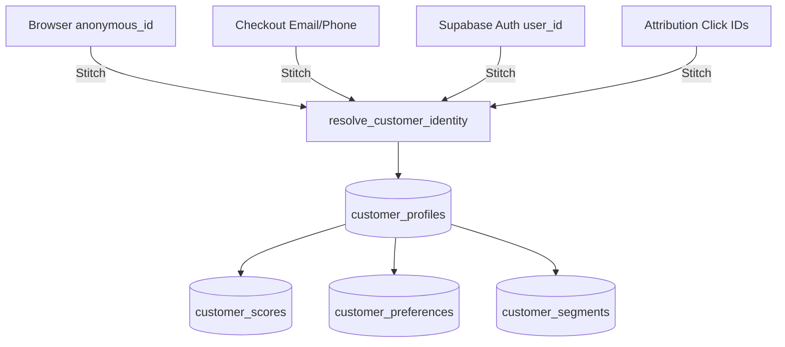

# PANTHER Customer 360 (CDP) Platform

This document describes the unified customer profile architecture (Customer Data Platform) serving as the single source of truth for marketing tracking, CRM automation, analytics, and personalization.

---

## 1. System Architecture

Instead of isolated tables querying checkout emails, user tables, and device tracking cookies, Customer 360 merges identities under a single unified profile:

---

## 2. Database Schema Details

The Customer 360 data layer is defined in the database migration file [037_customer_360.sql](file:///c:/Users/JAWAD%20KOROTH/Documents/legend-kart/Legend-kart/supabase/migrations/037_customer_360.sql):

1. **`customer_profiles`**: Holds standard user identifiers (`name`, `email`, `phone`).
2. **`customer_identity_links`**: Binds multiple devices, browser hashes, Google click IDs (`gclid`), and Facebook tracking parameters (`fbclid`) to a profile.
3. **`customer_scores`**: Dynamically aggregates Customer Lifetime Value (LTV), Average Order Value (AOV), purchase count, preferred payment channels, traffic UTM referrers, and active engagement metrics.
4. **`customer_preferences`**: Manages customer subscriptions and opt-ins for Email, SMS, WhatsApp, and Web Push notifications.
5. **`customer_segments`**: Holds calculated cohort memberships (e.g. VIP, High Spender, Browse Abandoner).
6. **`customer_activity_summary`**: Aggregates visitor activity categories day-by-day.

---

## 3. Customer Identity Resolution & Merging

When visitors land on the store, they are initially assigned a randomized `anonymous_id`. When they register or perform checkout, their profiles are stitched:

* **Stitching**: Resolved dynamically via the `resolve_customer_identity` PL/pgSQL function. It maps the incoming identifier type (e.g., `anonymous_id`, `user_id`, `email`, `phone`) to existing links. If no match is found, but the email/phone matches a profile, the identity is linked. If not, a new profile is created.
* **Merging**: If a customer registers their email/phone from a session that has a separate `anonymous_id` link matching a different profile, the two profiles are merged using the `merge_customer_profiles` script. All activity summaries, identity links, and segment records are transferred to the target profile.

---

## 4. Real-Time Aggregation Strategy

To avoid expensive full-table queries, calculations update in real-time through event-driven database triggers:

1. **`trg_orders_customer_sync`**: Fires immediately on order insert/updates, recalculating LTV, orders count, AOV, preferred categories, and automatically upgrading high spenders to the **VIP** segment.
2. **`trg_marketing_event_customer_sync`**: Fires immediately on any marketing event insertion (page views, products viewed, cart additions, checkouts), updating activity summaries, engagement scores, and last active timestamps.
